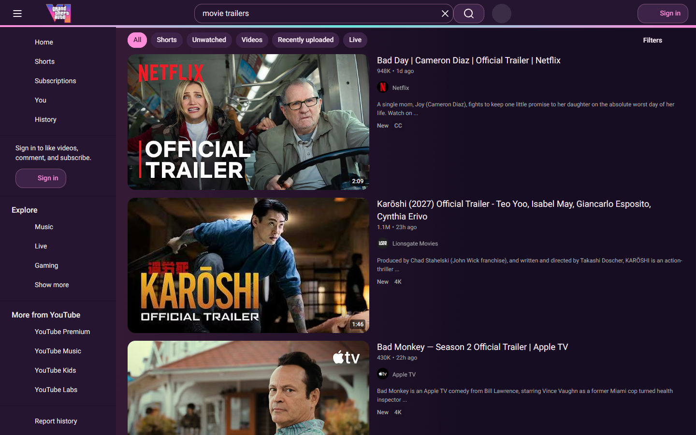
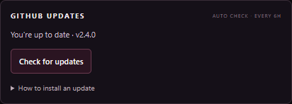
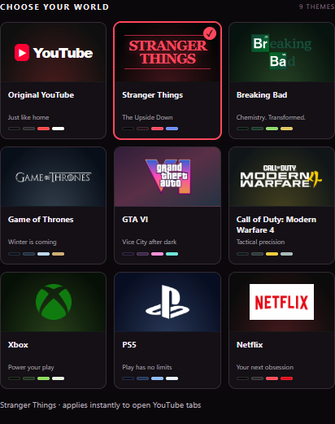
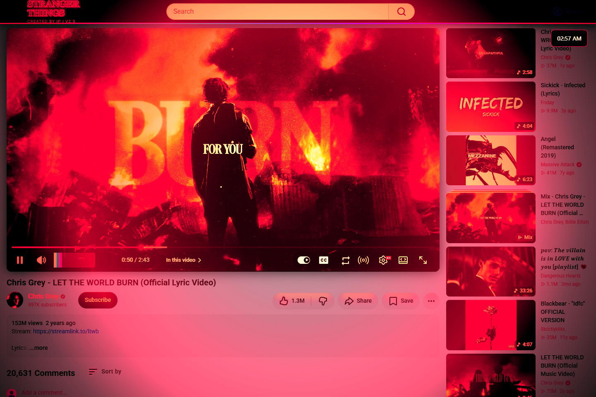
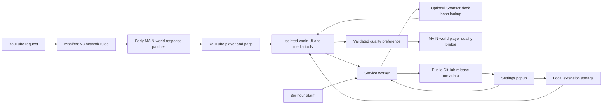

<div align="center">

# IPTUBE · Theme Studio

**Nine themes. One YouTube.**

Movie and gaming themes, live switching, GitHub release checks, and playback tools for desktop YouTube.

[](https://github.com/Mustafa1p/Anti-Youtube-Ads-Extension/releases/latest/download/iptube-browser-extension.zip)
[](https://github.com/Mustafa1p/Anti-Youtube-Ads-Extension/releases/tag/v2.4.0)
[](#quick-install)
[](https://www.youtube.com/watch?v=SkcO47UDzzY&list=RDSkcO47UDzzY&start_radio=1)


[](LICENSE)

</div>



_Actual v2.4.0 Chromium capture. The theme changes the interface while videos and thumbnails keep their original colors._

**New in v2.4.0:** a nine-card theme picker, immediate switching across open tabs, original YouTube appearance restoration, and automatic GitHub update checks. [See the release notes](https://github.com/Mustafa1p/Anti-Youtube-Ads-Extension/releases/tag/v2.4.0).

[Choose a theme](#theme-studio) · [Install](#quick-install) · [Update an existing installation](#updates-from-github) · [Development](#development)

## Quick install

1. **[Download the ZIP](https://github.com/Mustafa1p/Anti-Youtube-Ads-Extension/releases/latest/download/iptube-browser-extension.zip)** and extract it.
2. Open your browser's extensions manager:

   | Browser | Paste into the address bar |
   | ------- | -------------------------- |
   | Chrome  | `chrome://extensions`      |
   | Edge    | `edge://extensions`        |
   | Brave   | `brave://extensions`       |

3. Turn on **Developer mode**.
4. Choose **Load unpacked** and select the extracted **`extension`** folder containing `manifest.json`.
5. Refresh any open YouTube tabs, then pin the extension to open its settings.

The download contains the latest stable release, including an `extension` folder, README, license, and documentation. Select the `extension` folder itself when using **Load unpacked**.

**Updating:** replace your local files, click **Reload** on the extension card, then refresh YouTube. This project targets `https://www.youtube.com/` in desktop Chromium browsers. It does not provide a Firefox build, mobile app, or TV installation package.

## Updates from GitHub

Version 2.4.0 and later automatically check the latest stable GitHub Release every six hours while the browser is running, and check when you open the popup (using the same six-hour cache). The toolbar displays **NEW** when a newer packaged release exists. Use **Check for updates** to check immediately, then **Download v…** to download its ZIP. Only published stable releases containing `iptube-browser-extension.zip` are offered; prereleases and incomplete releases are ignored. Offline checks keep the previously discovered update available.

**Updating from v2.3.2 or earlier? Install v2.4.0 once using these steps to enable future update checks.**

1. Download the [latest release ZIP](https://github.com/Mustafa1p/Anti-Youtube-Ads-Extension/releases/latest/download/iptube-browser-extension.zip) and extract it.
2. Replace the contents of your existing extension folder with the new `extension` folder's contents. Keep the same installation path.
3. Open your browser's Extensions page and click **Reload** on IPTUBE.
4. Refresh YouTube. Your saved settings and theme selection stay in place; do not remove and reinstall the extension.

<p align="center">
  
</p>

_The released extension checking the real GitHub endpoint. When a newer stable release is available, this panel adds a versioned download button and the toolbar displays NEW._

This detects and downloads updates; it cannot silently replace an unpacked extension's files. Chrome requires a Web Store or managed deployment for automatic installation ([Chrome distribution documentation](https://developer.chrome.com/docs/extensions/how-to/distribute)). The updater requests only public release metadata from `api.github.com`, without cookies or an account token. GitHub sees the request's IP address; no video IDs, theme preferences, or browsing history are included. Downloading a release opens GitHub in your browser normally. No remote JavaScript is executed.

Source archive fallback: [download main](https://github.com/Mustafa1p/Anti-Youtube-Ads-Extension/archive/refs/heads/main.zip).

## Theme Studio

Open the extension popup and choose a card in **Choose your world**. Click once to apply; the selection is saved automatically.

<p align="center">
  
</p>

| Theme                          | Visual identity                                                             |
| ------------------------------ | --------------------------------------------------------------------------- |
| Original YouTube               | Native YouTube logo and original light/dark appearance                      |
| Stranger Things                | Crimson neon, dark atmosphere, serif branding, and special timeline effects |
| Breaking Bad                   | Chemical greens, yellow accents, periodic grid, and square controls         |
| Game of Thrones                | Icy steel, gold accents, serif headings, and sharp edges                    |
| GTA VI                         | Sunset pink, aqua highlights, and rounded controls                          |
| Call of Duty: Modern Warfare 4 | Tactical charcoal, yellow accents, diagonal texture, and angular controls   |
| Xbox                           | Green ambient light and dark gaming surfaces                                |
| PS5                            | Blue and white accents with curved controls                                 |
| Netflix                        | Red and black, restrained surfaces, and compact rectangular controls        |

Each theme has its own palette, display typography, background atmosphere, header logo, search styling, button geometry, menus, chips, scrollbars, playback progress, buffering spinner, and page loading line. Logos are bundled locally; selecting themes makes no requests to their source sites. Video frames and thumbnail imagery retain their original colors.

Selections persist locally and update open YouTube tabs immediately. Stranger Things remains the default for existing installations. **Original YouTube** removes the visual theme and restores the native logo and original light/dark appearance, while playback and cleanup preferences remain independent. Special timeline effects and ambilight run only in the Stranger Things theme; switching themes removes active overlays immediately.

After updating extension files, reload the extension and refresh YouTube once. Subsequent theme changes need no refresh. Current desktop Chromium is required for scoped theme CSS.

[View the full v2.4.0 settings popup](docs/screenshots/theme-studio.png).

## What you get

| Feature                   | What it does                                                                          | Default                             |
| ------------------------- | ------------------------------------------------------------------------------------- | ----------------------------------- |
| Theme Studio              | Nine saved visual themes with immediate switching across open YouTube tabs            | Stranger Things                     |
| GitHub updates            | Six-hour release checks, NEW badge, manual checking, and a download/install guide     | Automatic checking                  |
| Ad cleanup                | Scoped ad-serving rules, successful-player response cleanup, and native skip buttons  | On                                  |
| SponsorBlock              | Skips selected community-marked segments; seven categories are available              | Off; sponsors selected when enabled |
| Highest available quality | Requests the highest resolution exposed by YouTube's current player                   | Off                                 |
| Audio mode                | Hides the video picture while retaining sound and player controls                     | Off                                 |
| Sharper thumbnails        | Tries higher-resolution artwork and keeps the original when an upgrade is unavailable | Off                                 |
| On-screen clock           | Shows your local time, including within the fullscreen player                         | Off                                 |
| Hide header logo          | Hides the themed header logo                                                          | Off                                 |
| Reduce theme motion       | Stops decorative theme animations                                                     | Off                                 |
| Cinematic effects         | Enables the Stranger Things timeline and saved ambilight videos                       | On                                  |
| Playback extras           | Volume boost up to 500%, a loop button, and spatial audio simulation                  | Available in the player             |
| Cleaner browsing          | Shorts filtering, end-screen removal, and recommendation curation                     | On                                  |

Settings apply to open YouTube tabs. Quality selection uses YouTube's available streams and internal player methods: it cannot unlock Premium-only formats or create a resolution the video does not offer. Audio mode is a visual mode; it does **not** promise audio-only network traffic or reduced bandwidth. Spatial audio is an effect, not certified Dolby Atmos decoding.

## Enter the Upside Down

Open **[Chris Grey — LET THE WORLD BURN (Official Lyric Video)](https://www.youtube.com/watch?v=SkcO47UDzzY&list=RDSkcO47UDzzY&start_radio=1)** with the **Stranger Things** theme selected and **Cinematic effects** enabled.

The extension recognizes video ID `SkcO47UDzzY`; playlist and radio parameters do not change that match. It reads the video's current playback time every 500 ms and changes the atmosphere at these boundaries:

| Playback position | Atmosphere                                   |
| ----------------- | -------------------------------------------- |
| 0:00–0:45         | Normal Stranger Things theme                 |
| 0:45–0:46         | Blackout                                     |
| 0:46–1:07         | Burning: red treatment, flicker, and ash     |
| 1:07–1:46         | Freezing: cold treatment and drifting spores |
| 1:46–1:47         | Second blackout                              |
| 1:47–2:18         | Burning returns                              |
| 2:18–2:29         | Intense burning and screen shake             |
| 2:29 onward       | Freezing returns                             |

Ranges include their start and exclude their end. Seeking updates the effect to the destination; pausing keeps the current phase. Ads suspend the timeline. Navigating to another video removes the phase overlays and picks another background. Disable **Cinematic effects** to stop the timeline and ambilight; **Reduce theme motion** stops animated decoration while retaining the color treatment.

### Feeling with IP mode

Add a YouTube link or video ID in the popup to enable ambilight for that video. While it plays, the extension samples a small video canvas every 100 ms and uses the sampled color for the ambient glow and header accents. It stops on pause, during ads, when you leave the video, and when you switch themes. Select **Stranger Things** and enable **Cinematic effects** to use ambilight. The special demo's timeline takes priority over ambilight.

Canvas sampling depends on browser access to video pixels. If the browser blocks pixel reads, playback continues but the glow may not update.



_An earlier Chromium capture of the Stranger Things timeline effect, which remains available in Theme Studio. The on-screen clock is optional._

## If YouTube blocks playback

Open the extension popup, turn **YouTube ad blocking** off, then reload open YouTube tabs. The pause setting survives browser restarts; other features remain available. When a recognized YouTube enforcement warning appears, the page also offers **Pause ad blocking and reload**. Ads may play while paused. Other blockers can still interfere.

This release removes broad identity/integrity spoofing, forced success states and automatic site-data deletion. It prioritizes recovery and playback reliability; it cannot guarantee permanent ad blocking or reverse server-side restrictions. See the [investigation, source links and verification limits](docs/youtube-playback-research.md).

## How the browser extension works



- **Before the page starts:** saved settings enable scoped ad-serving rules. Page cleanup waits for the stored mode, preserves identity and integrity data, and only prunes exact ad fields from successful player responses. YouTube storage is preserved.
- **After the page is ready:** feature scripts attach controls, batch DOM cleanup, follow YouTube navigation, and apply local preferences.
- **For segment skipping:** the service worker validates the video ID, checks the saved opt-in, queries SponsorBlock, filters its response, and caches results. The content script ignores stale navigation responses and merges overlapping skips.
- **For themes:** the popup saves an allowlisted theme ID, open YouTube tabs apply its local palette and artwork, and Original restores native branding and appearance.
- **For updates:** a service-worker alarm checks public GitHub release metadata every six hours; the popup also checks on open using the same cache. Only the exact stable release ZIP is offered.
- **For quality:** a narrow message bridge passes a boolean preference into the page world, where the extension can access the player methods. It requests quality once per video/available-quality combination rather than continuously overriding your selection.

YouTube changes frequently. Ad blocking, internal player methods, thumbnail availability, and community segment coverage are best effort. This extension does not guarantee uninterrupted playback or bypass account, region, age, or subscription requirements.

## Educational purpose

This project is provided for educational study of browser extensions, media controls, and page customization. Use it responsibly and respect applicable platform terms and third-party rights. Educational use does not guarantee compatibility, platform approval, or continued hosting.

See the [browser implementation notes](docs/architecture.md) for the design and compatibility boundaries.

## Privacy and permissions

Preferences and ambilight video IDs are stored in `chrome.storage.local`. The extension does not add an analytics backend.

**SponsorBlock is off by default.** When enabled, its service receives a four-character SHA-256 prefix of the current video ID and the selected categories. The response contains a bucket of candidate videos, which is filtered locally. No cookies or account credentials are included, but the service can see your IP address; a short hash prefix is not a guarantee of anonymity.

| Permission / host               | Purpose                                                                                        |
| ------------------------------- | ---------------------------------------------------------------------------------------------- |
| `storage`                       | Theme and feature preferences, ambilight IDs, counters, and cached update metadata             |
| `alarms`                        | Schedule GitHub release checks every six hours                                                 |
| `declarativeNetRequest`         | Scoped YouTube ad-serving rules                                                                |
| `declarativeNetRequestFeedback` | Request-count diagnostics in unpacked development builds                                       |
| YouTube and Googlevideo hosts   | YouTube page integration and network rules                                                     |
| `sponsorblock.inf.re`           | Optional SponsorBlock lookup                                                                   |
| `api.github.com`                | Public latest-release metadata; no cookies, account token, video IDs, or browsing history sent |

The extension does not clear YouTube cookies, site storage, IndexedDB, or service workers. It does not request browsing-data, scripting, or active-tab permissions. Theme logos and backgrounds are bundled locally.

## Contributing

Start with **[CONTRIBUTING.md](CONTRIBUTING.md)** for setup, architecture boundaries, tests, and pull requests. See the **[changelog](CHANGELOG.md)** for changes and **[release guide](docs/releasing.md)** for packaging and publishing. Bug reports and feature requests have GitHub issue templates.

## Development

Use Node.js 22 or later. Install the pinned development tools with `npm ci`. The extension has no runtime npm dependencies.

```sh
npm ci
npm run check
npm run package
```

The package is written to `dist/iptube-browser-extension.zip`. Extract it and load its `extension` directory. Packaging uses a runtime file list derived from the manifest, popup dependencies, and service-worker imports. Browser-generated metadata, development helpers, and unrelated files are excluded. GitHub Actions runs tests and attaches the ZIP as a build artifact; downloading Actions artifacts requires GitHub access.

| File                                                         | Responsibility                                                                  |
| ------------------------------------------------------------ | ------------------------------------------------------------------------------- |
| `extension/manifest.json`                                    | Permissions, script order, page worlds, and assets                              |
| `background.js`, `sponsorBlockService.js`                    | Counters and optional segment lookup                                            |
| `featureSettings.js`, `videoSettings.js`                     | Typed settings, video validation, and persistence                               |
| `earlyPatch.js`, `playbackSafety.js`, `adBlockingService.js` | Scoped player cleanup, saved blocking mode and recovery                         |
| `contentScript.js`, `contentConfig.js`                       | Startup, ad cleanup, selectors, and DOM observation                             |
| `sidebar.js`, `mediaControls.js`, `branding.js`              | Recommendation filtering, media tools, and branding                             |
| `browserFeatures.js`, `playerQuality.js`                     | Desktop enhancements and quality bridge                                         |
| `backgroundRandomizer.js`, `style.css`                       | Backgrounds, timeline, and ambilight                                            |
| `themeSettings.js`, `themeController.js`, `themes.css`       | Shared theme catalog, scoped palettes, live application, and native restoration |
| `themePicker.js`                                             | Theme grid, selected state, and serialized selection saves                      |
| `updateService.js`, `updatePopup.js`                         | GitHub release validation, caching, alarms, badges, and update UI               |
| `popup.html`, `popup.css`, `popup.js`                        | Settings interface                                                              |

Paths in the table are inside `extension/`. Classic content scripts share an isolated-world scope and must retain the manifest loading order. MAIN-world scripts cannot directly access extension storage.

Automated checks cover syntax, manifest assets, script loading, settings validation, counter concurrency, SponsorBlock lookup/caching, network errors, quality selection, overlap handling, stale navigation responses, theme persistence, version comparison, release validation, and offline update checks.

Optional browser runtime checks require Playwright and its Chromium browser:

```sh
npm install --no-save --package-lock=false playwright
npx playwright install chromium
npm run test:browser
npm run test:themes
npm run test:updates
```

`test:browser` verifies playback cleanup and recovery controls. `test:themes` exercises all nine themes, rendered colors and controls, native restoration, saved selection, multiple tabs, SPA header replacement, keyboard activation, and timeline cleanup. `test:updates` exercises new/current releases, toolbar badges, exact download links, cached reopen, scheduled alarms, and offline handling using controlled GitHub responses in an actual MV3 service worker.

For live verification, reload the extension and check regular playback, SPA navigation, the popup, demo boundaries, and **Check for updates** against GitHub. The v2.4.0 release passed all 31 automated tests, the packaged Chromium checks, and GitHub CI on Windows/Ubuntu with Node 22/24. The public release ZIP's integrity and the updater's real GitHub request were also verified. Edge/Brave and signed-in account layouts were not tested. Screenshots in this README are real Chromium captures.

## Troubleshooting

- **Nothing changed:** load the folder containing `manifest.json`, enable the extension, and refresh YouTube. An already-open tab needs a refresh after reloading the extension.
- **SponsorBlock did not skip:** enable it in the popup and check the selected categories. Community data may be missing; network errors leave playback untouched.
- **Quality stayed lower:** wait for the player to expose its streams. The toggle requests available quality; YouTube, your connection, and device capabilities still determine playback.
- **Demo effects are missing:** select **Stranger Things**, check the video ID, and enable **Cinematic effects**. The first transition starts at 0:45.
- **No update button:** it appears only when a newer stable release with its ZIP is published. Use **Check for updates** to bypass the six-hour cache. Offline or rate-limited checks show a retry message.
- **Still on an older version:** download the ZIP, replace files at the same installation path, click **Reload**, and refresh YouTube. Releases before v2.4.0 have no update checker.
- **The effects are too busy:** enable **Reduce theme motion** or disable **Cinematic effects**.

## Credits and license

Created by IP. Bundled backgrounds and the spatial-audio icon are original procedural SVGs. Theme logos are third-party brand assets; their sources and rights notes are recorded in the [asset inventory](docs/assets.md). Community segment data is provided by [SponsorBlock](https://sponsor.ajay.app/). This is an independent project and is not affiliated with YouTube, Google, Netflix, LG, or Dolby. The demo video and third-party imagery visible in browser screenshots belong to their respective owners.

Project code is licensed under [MIT](LICENSE). Third-party artwork and trademarks are not relicensed by that code license.
