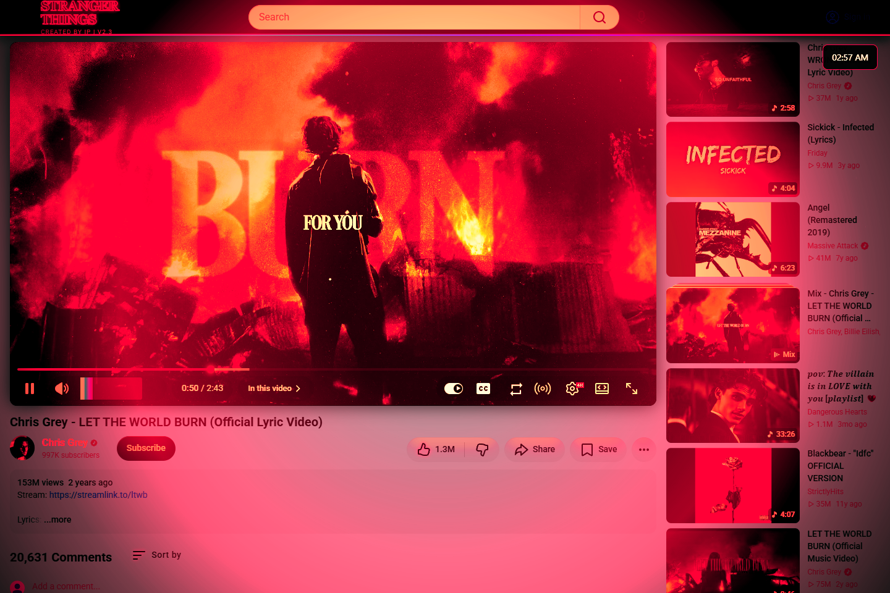
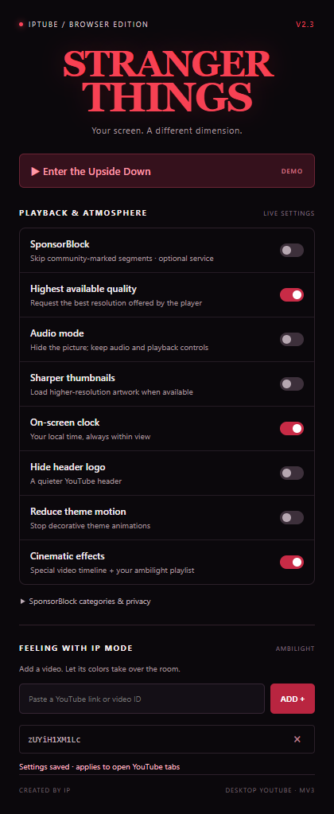
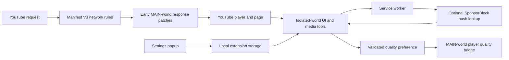

<div align="center">

# IPTUBE · Stranger Things Edition

**A different dimension for desktop YouTube.**

Ad cleanup, optional SponsorBlock, playback tools, and a cinematic theme that follows the music.

[](https://github.com/Mustafa1p/Anti-Youtube-Ads-Extension-/archive/refs/heads/main.zip)
[](#quick-install)
[](https://www.youtube.com/watch?v=SkcO47UDzzY&list=RDSkcO47UDzzY&start_radio=1)


[](LICENSE)

</div>



_Actual Chromium capture with the unpacked extension loaded. Burning mode is activated by the demo video's playback position; the clock is optional._

## Quick install

1. **[Download the ZIP](https://github.com/Mustafa1p/Anti-Youtube-Ads-Extension-/archive/refs/heads/main.zip)** and extract it.
2. Open your browser's extensions manager:

   | Browser | Paste into the address bar |
   | ------- | -------------------------- |
   | Chrome  | `chrome://extensions`      |
   | Edge    | `edge://extensions`        |
   | Brave   | `brave://extensions`       |

3. Turn on **Developer mode**.
4. Choose **Load unpacked** and select the extracted **`extension`** folder containing `manifest.json`.
5. Refresh any open YouTube tabs, then pin the extension to open its settings.

The buttons above download the repository and jump to these instructions. Chromium requires you to confirm installation in its extensions manager; a README cannot silently install an extension. The download contains the version currently published on `main`.

**Updating:** replace your local files, click **Reload** on the extension card, then refresh YouTube. This project targets `https://www.youtube.com/` in desktop Chromium browsers. It does not provide a Firefox build, mobile app, or TV installation package.

## What you get

| Feature                   | What it does                                                                                              | Default                             |
| ------------------------- | --------------------------------------------------------------------------------------------------------- | ----------------------------------- |
| Ad cleanup                | Declarative network rules, early response patching, and DOM cleanup remove matched ads and residual ad UI | On                                  |
| SponsorBlock              | Skips selected community-marked segments; seven categories are available                                  | Off; sponsors selected when enabled |
| Highest available quality | Requests the highest resolution exposed by YouTube's current player                                       | Off                                 |
| Audio mode                | Hides the video picture while retaining sound and player controls                                         | Off                                 |
| Sharper thumbnails        | Tries higher-resolution artwork and keeps the original when an upgrade is unavailable                     | Off                                 |
| On-screen clock           | Shows your local time, including within the fullscreen player                                             | Off                                 |
| Hide header logo          | Hides the themed header logo                                                                              | Off                                 |
| Reduce theme motion       | Stops decorative theme animations                                                                         | Off                                 |
| Cinematic effects         | Enables the special-video timeline and saved ambilight videos                                             | On                                  |
| Playback extras           | Volume boost up to 500%, a loop button, and spatial audio simulation                                      | Available in the player             |
| Cleaner browsing          | Shorts filtering, end-screen removal, and recommendation curation                                         | On                                  |

Settings apply to open YouTube tabs. Quality selection uses YouTube's available streams and internal player methods: it cannot unlock Premium-only formats or create a resolution the video does not offer. Audio mode is a visual mode; it does **not** promise audio-only network traffic or reduced bandwidth. Spatial audio is an effect, not certified Dolby Atmos decoding.

## Enter the Upside Down

Open **[Chris Grey — LET THE WORLD BURN (Official Lyric Video)](https://www.youtube.com/watch?v=SkcO47UDzzY&list=RDSkcO47UDzzY&start_radio=1)** with **Cinematic effects** enabled.

The extension recognizes video ID `SkcO47UDzzY`; playlist and radio parameters do not change that match. It reads the video's current playback time every 500 ms and changes the atmosphere at these boundaries:

| Playback position | Atmosphere                                   |
| ----------------- | -------------------------------------------- |
| 0:00–0:45         | Normal Stranger Things theme                 |
| 0:45–0:46         | Blackout                                     |
| 0:46–1:07         | Burning: red treatment, flicker, and ash     |
| 1:07–1:46         | Freezing: cold treatment and drifting spores |
| 1:46–1:47         | Second blackout                              |
| 1:47–2:18         | Burning returns                              |
| 2:18–2:29         | Intense burning and screen shake             |
| 2:29 onward       | Freezing returns                             |

Ranges include their start and exclude their end. Seeking updates the effect to the destination; pausing keeps the current phase. Ads suspend the timeline. Navigating to another video removes the phase overlays and picks another background. Disable **Cinematic effects** to stop the timeline and ambilight; **Reduce theme motion** stops animated decoration while retaining the color treatment.

### Feeling with IP mode

Add a YouTube link or video ID in the popup to enable ambilight for that video. While it plays, the extension samples a small video canvas every 100 ms and uses the sampled color for the ambient glow and header accents. It stops on pause, during ads, and when you leave the video. The special demo's timeline takes priority over ambilight.

Canvas sampling depends on browser access to video pixels. If the browser blocks pixel reads, playback continues but the glow may not update.

<p align="center">
  
</p>

_The screenshot shows highest quality and the clock enabled. Optional features are off on a fresh installation._

## How the browser extension works



- **Before the page starts:** network rules block matching ad requests. MAIN-world scripts patch page APIs; the storage sanitizer removes matching detection markers.
- **After the page is ready:** feature scripts attach controls, batch DOM cleanup, follow YouTube navigation, and apply local preferences.
- **For segment skipping:** the service worker validates the video ID, checks the saved opt-in, queries SponsorBlock, filters its response, and caches results. The content script ignores stale navigation responses and merges overlapping skips.
- **For quality:** a narrow message bridge passes a boolean preference into the page world, where the extension can access the player methods. It requests quality once per video/available-quality combination rather than continuously overriding your selection.

YouTube changes frequently. Ad blocking, internal player methods, thumbnail availability, and community segment coverage are best effort. This extension does not guarantee uninterrupted playback or bypass account, region, age, or subscription requirements.

## What came from the webOS research

The [webosbrew/youtube-webos](https://github.com/webosbrew/youtube-webos) project inspired the browser feature selection. Its TV launch path, response hooks, player manager, settings, SponsorBlock, quality, thumbnail, and clock modules were reviewed at commit [`f1b3b72`](https://github.com/webosbrew/youtube-webos/tree/f1b3b72926bb0cc312b5ceddc6a5b8c8ca081914).

The portable feature ideas have separate browser implementations here. The TV launcher, remote-button mappings, account selector, Luna services, casting integration, and screensaver fixes remain specific to webOS. Existing desktop ad cleanup, Shorts filtering, and end-screen removal are retained.

See **[the implementation notes](docs/webos-research.md)** for the source map, design decisions, and compatibility boundaries. Upstream is GPL-3.0-only; no upstream source files are bundled in this MIT project. Credit remains with its contributors and the SponsorBlock community.

## Privacy and permissions

Preferences and ambilight video IDs are stored in `chrome.storage.local`. The extension does not add an analytics backend.

**SponsorBlock is off by default.** When enabled, its service receives a four-character SHA-256 prefix of the current video ID and the selected categories. The response contains a bucket of candidate videos, which is filtered locally. No cookies or account credentials are included, but the service can see your IP address; a short hash prefix is not a guarantee of anonymity.

YouTube host access supports page integration and network rules. The SponsorBlock host permission allows the service worker's optional API request. Storage saves settings and counters. The existing browsing-data permission clears YouTube cache/site storage on install or update while preserving cookies; some local YouTube preferences may reset. The network-debug permission supports request-count diagnostics in unpacked development builds. Unused scripting and active-tab permissions have been removed.

## Contributing

Start with **[CONTRIBUTING.md](CONTRIBUTING.md)** for setup, architecture boundaries, tests, and pull requests. See the **[changelog](CHANGELOG.md)** for changes and **[release guide](docs/releasing.md)** for packaging and publishing. Bug reports and feature requests have GitHub issue templates.

## Development

Use Node.js 22 or later. Install the pinned development tools with `npm ci`. The extension has no runtime npm dependencies.

```sh
npm ci
npm run check
npm run package
```

The package is written to `dist/iptube-browser-extension.zip`. Extract it and load its `extension` directory. Packaging uses a runtime file list derived from the manifest, popup dependencies, and service-worker imports. Browser-generated metadata, development helpers, and unrelated files are excluded. GitHub Actions runs tests and attaches the ZIP as a build artifact; downloading Actions artifacts requires GitHub access.

| File                                                 | Responsibility                                      |
| ---------------------------------------------------- | --------------------------------------------------- |
| `extension/manifest.json`                            | Permissions, script order, page worlds, and assets  |
| `background.js`, `sponsorBlockService.js`            | Counters and optional segment lookup                |
| `featureSettings.js`, `videoSettings.js`             | Typed settings, video validation, and persistence   |
| `earlyPatch.js`, `antiBot.js`, `storageSanitizer.js` | Early page hooks and storage handling               |
| `contentScript.js`, `contentConfig.js`               | Startup, ad cleanup, selectors, and DOM observation |
| `sidebar.js`, `mediaControls.js`, `branding.js`      | Recommendation filtering, media tools, and branding |
| `browserFeatures.js`, `playerQuality.js`             | Desktop enhancements and quality bridge             |
| `backgroundRandomizer.js`, `style.css`               | Backgrounds, timeline, and ambilight                |
| `popup.html`, `popup.css`, `popup.js`                | Settings interface                                  |

Paths in the table are inside `extension/`. Classic content scripts share an isolated-world scope and must retain the manifest loading order. MAIN-world scripts cannot directly access extension storage.

Automated checks cover syntax, manifest assets, script loading, settings validation, counter concurrency, hash lookup/caching, network errors, quality selection, overlap handling, and stale navigation responses. For browser verification, reload the extension and check regular playback, SPA navigation, the popup, and demo boundaries. Screenshots in this README were captured from Chromium with the unpacked extension loaded.

## Troubleshooting

- **Nothing changed:** load the folder containing `manifest.json`, enable the extension, and refresh YouTube. An already-open tab needs a refresh after reloading the extension.
- **SponsorBlock did not skip:** enable it in the popup and check the selected categories. Community data may be missing; network errors leave playback untouched.
- **Quality stayed lower:** wait for the player to expose its streams. The toggle requests available quality; YouTube, your connection, and device capabilities still determine playback.
- **Demo effects are missing:** check the video ID and **Cinematic effects**. The first transition starts at 0:45.
- **The effects are too busy:** enable **Reduce theme motion** or disable **Cinematic effects**.

## Credits and license

Created by IP. Bundled backgrounds and the spatial-audio icon are original procedural SVGs; see the [asset inventory](docs/assets.md). Thanks to [webosbrew/youtube-webos](https://github.com/webosbrew/youtube-webos) for the feature inspiration and [SponsorBlock](https://sponsor.ajay.app/) for community segment data. This is an independent project and is not affiliated with YouTube, Google, Netflix, LG, or Dolby. The demo video and third-party imagery visible in browser screenshots belong to their respective owners.

Project code is licensed under [MIT](LICENSE). Third-party artwork and trademarks are not relicensed by that code license.
